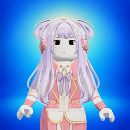
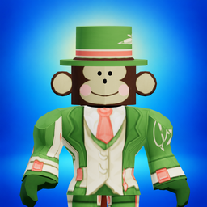
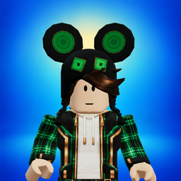
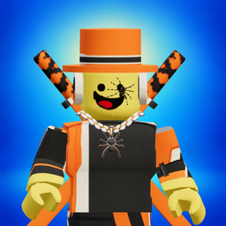
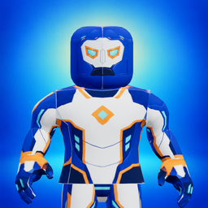
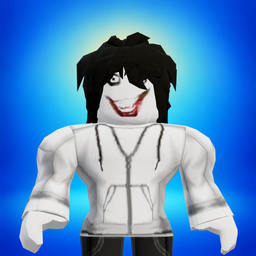

# Материалы инап-покупок

Шесть постоянных товаров. ID совпадают с `PREMIUM_SKIN_IDS` и `premiumProductId()` в `dist/premium-skins.js`; переименовывать их в консоли отдельно от кода нельзя.

| Иконка | Персонаж | ID товара | PNG |
| --- | --- | --- | --- |
|  | Dancing NPC Girl | `skin_dancing-npc-girl` | [Скачать](icons/skin_dancing-npc-girl.png) |
|  | Jandel | `skin_jandel` | [Скачать](icons/skin_jandel.png) |
|  | KreekCraft | `skin_kreekcraft` | [Скачать](icons/skin_kreekcraft.png) |
|  | Spyder Sammy | `skin_spyder-sammy` | [Скачать](icons/skin_spyder-sammy.png) |
|  | Spider-Man | `skin_spider-man` | [Скачать](icons/skin_spider-man.png) |
|  | Jeff the Killer | `skin_jeff-the-killer` | [Скачать](icons/skin_jeff-the-killer.png) |

[products.csv](products.csv) содержит обязательные поля для импорта: `id`, `price`, `title_en`, `description_en`, `title_ru`, `description_ru`. Описания короче 200 символов. Цена 39 указана в портальной валюте; для целевой стоимости 39 рублей проверьте региональную стоимость в Консоли Яндекс Игр. Изображения загружаются отдельно в карточке каждого товара после импорта CSV.

Формат финальных иконок: PNG, 256×256, непрозрачный фон, без текста, цен и значков валюты. Размер подтверждён по [документации консоли](https://yandex.ru/dev/games/doc/ru/console/purchases). Эти файлы предназначены для консоли и не включаются в игровой `build/`.

Иконки обновлены 17 октября 2026 года после изменения игровых костюмов. Персонажи отрисованы непосредственно из актуальных GLB игровым загрузчиком `createCharacterDisplay`: геометрия, лица, текстуры и аксессуары совпадают с игрой. SHA256 всех шести моделей сверены с архивом Яндекса `output/yandex-1.70.1.zip`. Соответствие костюмов: Dancing NPC Girl — Coral Pop Idol, Jandel — Space Gardener, KreekCraft — Emerald Cyber Plaid, Spyder Sammy — Hazard Tech, Spider-Man — Future Hero; Jeff the Killer использует оригинальную неизменённую модель и костюм.

Общий сине-бирюзовый [фон](background.png) с мягким золотистым светом создан встроенным `image_gen`. Персонажи не генерировались и не перерисовывались. Мастера 1024×1024 сохранены в [masters](masters/); для консоли используйте версии 256×256 из `icons/`. Промпт фона, контрольные суммы и привязки моделей: [generation-prompts.json](generation-prompts.json).

Для повторного рендера раздайте корень репозитория локальным HTTP-сервером и откройте [render-icons.html](render-icons.html). Страница загружает текущие игровые GLB и экспортирует отдельный PNG каждого персонажа. Это инструмент подготовки материалов, в игровую сборку он не входит.

Перед публикацией проверьте активность всех шести товаров, их ID, персональные иконки, фактическую стоимость и восстановление постоянных прав после повторного входа.
